<a href="https://github.com/Yide-Milo-Li">
  <picture>
    <source media="(prefers-color-scheme: dark)" srcset="assets/header-dark.svg" />
    
  </picture>
</a>

  <a href="https://personal-homepage.yideli.workers.dev">Homepage</a> ·
  <a href="#projects">Projects</a> ·
  <a href="#stack">Stack</a> ·
  <a href="#activity">Activity</a>

## About

I study Computer Science at UC Irvine 🐜. Most of what I build is software you install and own: native desktop apps, local-first data, and tools that still work when the Wi-Fi doesn't.

- These days I write C++20 with Qt 6 / QML, and TypeScript on Tauri with a bit of Rust underneath.
- I care about the boring parts too: reproducible CMake builds, CI, release packaging, and docs people actually read.
- Off the clock I invent board-game rules and then have to write the engine for them.
- My internship, research and playable demos of these projects are on [my homepage](https://personal-homepage.yideli.workers.dev).

## Projects

<!-- projects:start -->
<a href="https://github.com/Yide-Milo-Li/LeetCode-Tracker"><picture><source media="(prefers-color-scheme: dark)" srcset="https://raw.githubusercontent.com/Yide-Milo-Li/Yide-Milo-Li/output/leetcode-tracker-dark.svg" /></picture></a>
<a href="https://github.com/Yide-Milo-Li/AnteaterChess-Reborn"><picture><source media="(prefers-color-scheme: dark)" srcset="https://raw.githubusercontent.com/Yide-Milo-Li/Yide-Milo-Li/output/anteaterchess-reborn-dark.svg" /></picture></a>

<a href="https://github.com/Yide-Milo-Li/AnteaterPoker"><picture><source media="(prefers-color-scheme: dark)" srcset="https://raw.githubusercontent.com/Yide-Milo-Li/Yide-Milo-Li/output/anteaterpoker-dark.svg" /></picture></a>
<picture><source media="(prefers-color-scheme: dark)" srcset="https://raw.githubusercontent.com/Yide-Milo-Li/Yide-Milo-Li/output/agentrelay-dark.svg" /></picture>
<!-- projects:end -->

## Stack

  

## Activity

<picture>
  <source media="(prefers-color-scheme: dark)" srcset="https://raw.githubusercontent.com/Yide-Milo-Li/Yide-Milo-Li/output/stats-dark.svg" />
  
</picture>
<picture>
  <source media="(prefers-color-scheme: dark)" srcset="https://raw.githubusercontent.com/Yide-Milo-Li/Yide-Milo-Li/output/languages-dark.svg" />
  
</picture>

<picture>
  <source media="(prefers-color-scheme: dark)" srcset="https://raw.githubusercontent.com/Yide-Milo-Li/Yide-Milo-Li/output/contrib3d-dark.svg" />
  
</picture>

<picture>
  <source media="(prefers-color-scheme: dark)" srcset="https://raw.githubusercontent.com/Yide-Milo-Li/Yide-Milo-Li/output/snake-dark.svg" />
  
</picture>

Stats and star counts refresh every 6 hours via <a href=".github/workflows/profile-assets.yml">a GitHub Action</a> in this repo. Zot zot! 🐜
